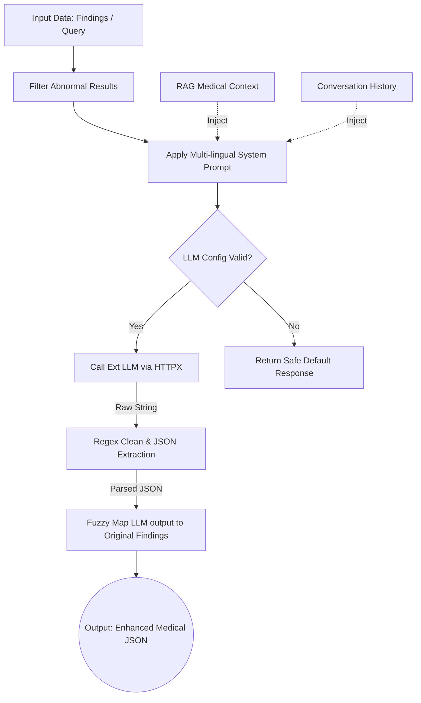

# MedExplain AI: LLM Service Technical Architecture

## Technical Workflow (`llm_service.py`)

This document outlines the technical workflow and architecture scaling for `llm_service.py`, which handles all interactions between MedExplain AI and the underlying language model to generate patient-friendly interpretations of medical reports.

### 1. Initialization
- Establishes a connection to an OpenAI-compatible API via `httpx`.
- Injects a strict `SYSTEM_PROMPT` ensuring the AI behaves as an explainer, not a doctor.

### 2. Explanation Generation (`generate_explanation`)
- Filters inputs to isolate abnormal test results (up to 12).
- Dynamically translates the system instruction into the user's localized language (e.g., English, Hindi, Arabic).
- Requests a strict JSON output containing a brief summary, synthetic overall outcome, and 4-6 sentence explanations per finding.
- Cleans the raw LLM output, extracts the JSON, and uses fuzzy string matching to merge the new AI explanations back with the original finding data.

### 3. Chat Response Generation (`generate_chat_response`)
- Ingests patient questions alongside RAG (Retrieval-Augmented Generation) context and a rolling 5-message conversation history.
- Outputs a verified answer enforcing strict safety guardrails.

## Architectural Diagram

